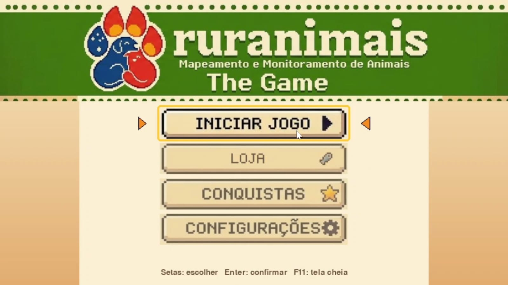
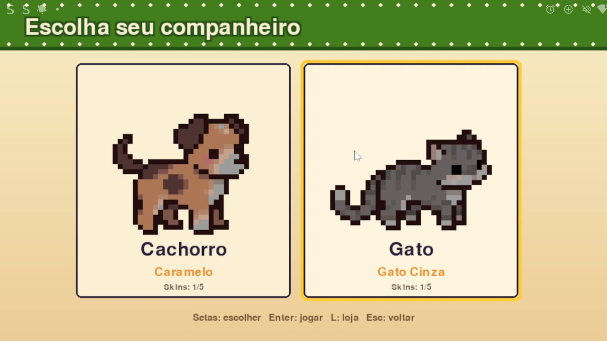
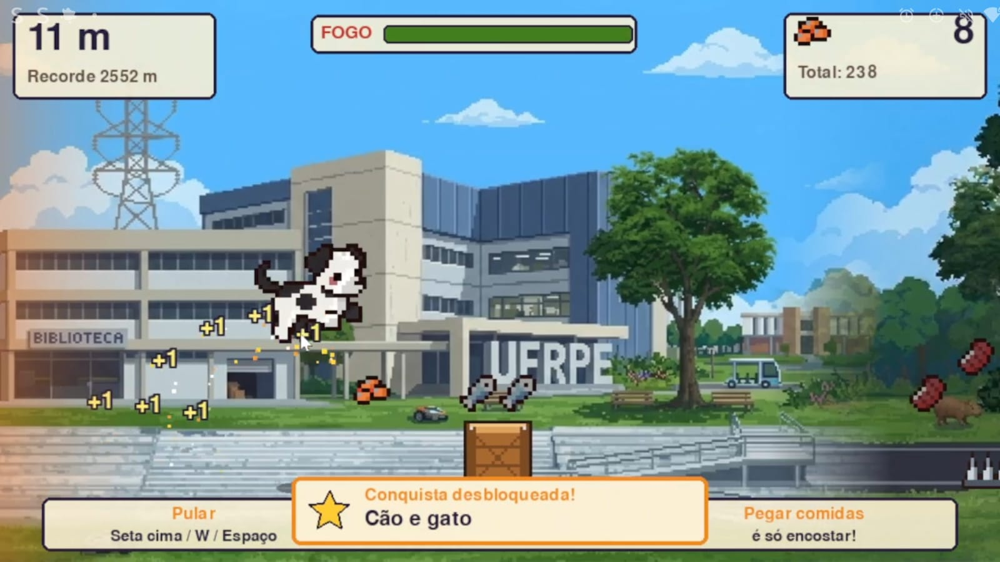
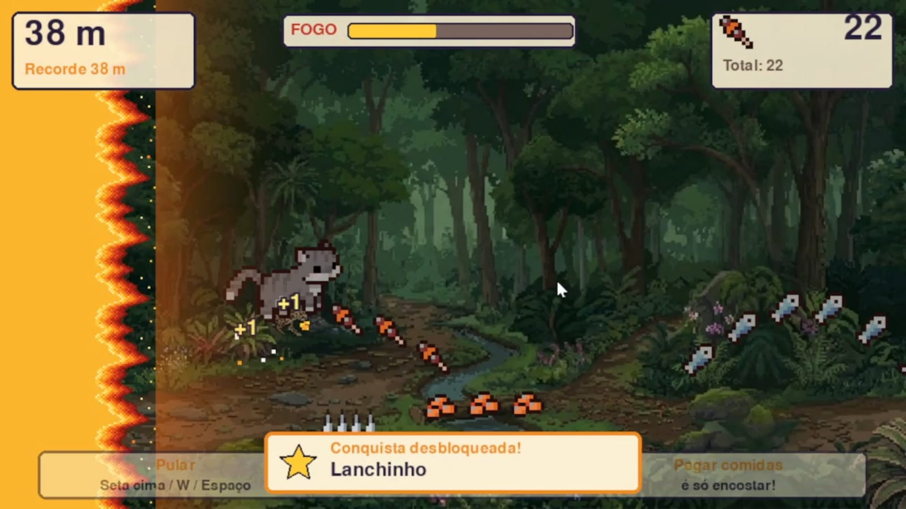
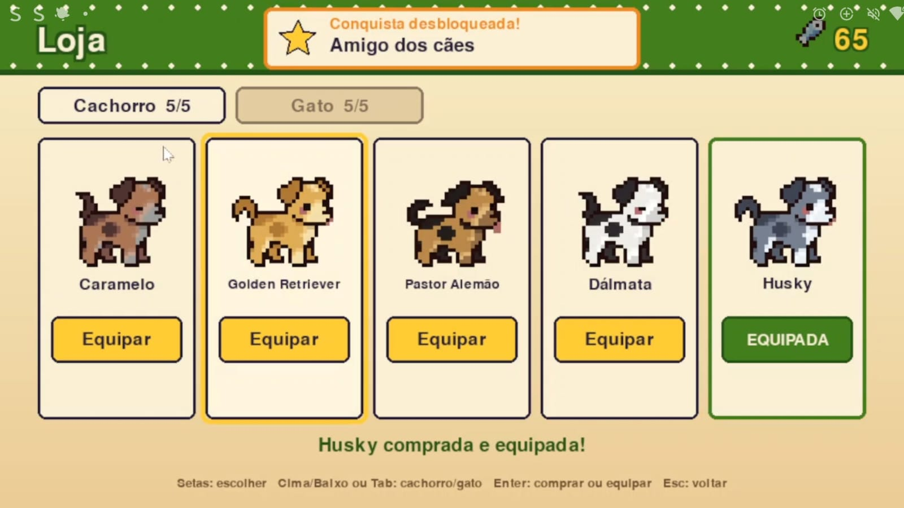
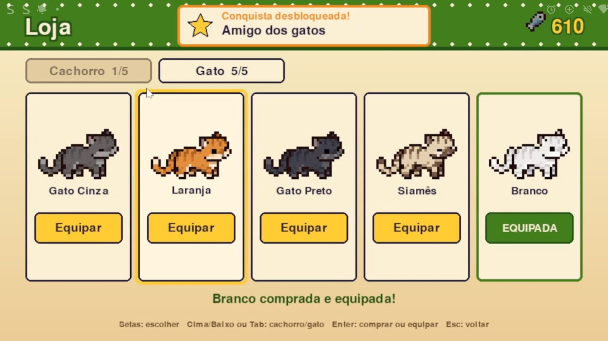
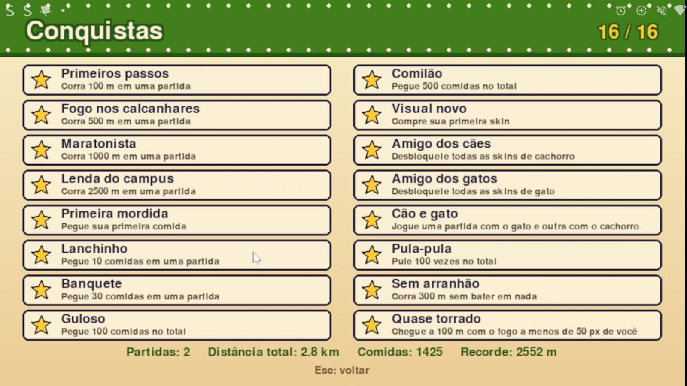

# 🐾 Ruranimais - The Game

<p align="center">
  
</p>

Um jogo de corrida infinita desenvolvido em Python com a biblioteca PyGame. Escolha entre um gato ou um cachorro, corra por diferentes cenários, desvie de obstáculos, colete comidas e fuja de uma parede de fogo que se aproxima constantemente.

As comidas coletadas durante as partidas são convertidas em moedas, que podem ser utilizadas para desbloquear novas skins na loja do jogo.

---

## 🎮 Sobre o projeto

O **Ruranimais - The Game** é um jogo inspirado no gênero *Endless Runner*, no qual o personagem corre automaticamente enquanto o jogador precisa superar obstáculos e sobreviver pelo maior tempo possível.

O projeto apresenta diferentes mecânicas de movimentação, animações, cenários progressivos, sistema de pontuação, conquistas e personalização dos personagens.

O jogador pode escolher entre cães e gatos, cada um com diferentes aparências desbloqueáveis.

<p align="center">
  
</p>

## 📸 Capturas de tela

| Campus | Floresta |
|---|---|
|  |  |

## 🚀 Funcionalidades

- **Seleção de personagem:** escolha entre cachorro e gato.
- **Sistema de movimentação:** pule e deslize para superar obstáculos.
- **Obstáculos dinâmicos:** desvie de caixotes, espinhos e barreiras.
- **Sistema de coleta:** encontre comidas espalhadas pelos cenários.
- **Parede de fogo:** fuja de uma ameaça que se aproxima durante a partida.
- **Loja de skins:** utilize as moedas acumuladas para desbloquear novas aparências.
- **Sistema de conquistas:** complete desafios e desbloqueie conquistas.
- **Recordes e estatísticas:** acompanhe suas melhores pontuações e seu progresso.
- **Cenários progressivos:** explore diferentes ambientes durante a corrida.
- **Sistema de áudio:** música e efeitos sonoros configuráveis.
- **Sistema de pausa:** interrompa e retome as partidas.
- **Configurações:** personalize opções de áudio e tela cheia.
- **Salvamento automático:** mantenha moedas, recordes, skins e conquistas entre as partidas.

## 🛠️ Tecnologias utilizadas

| Tecnologia | Utilização |
|---|---|
| Python | Linguagem principal do projeto |
| PyGame | Desenvolvimento do jogo, gráficos, animações, áudio e controles |
| JSON | Armazenamento do progresso e das configurações do jogador |

## 📂 Estrutura do projeto

```text
ruranimais/
│
├── assets/
│   ├── animais/
│   │   ├── cachorro/
│   │   └── gato/
│   ├── cenarios/
│   ├── objetos/
│   └── sons/
│
├── arte_original/
│
├── docs/
│   └── screenshots/
│
├── tools/
│   ├── gerar_pixelart.py
│   ├── gerar_sons.py
│   ├── preparar_animais.py
│   ├── preparar_cenarios.py
│   └── preparar_sprites.py
│
├── assets.py
├── cenario.py
├── config.py
├── estatisticas.py
├── logica.py
├── main.py
├── mundo.py
├── skins.py
├── telas.py
│
├── requirements.txt
└── README.md
```

### 📌 Organização dos arquivos principais

| Arquivo | Responsabilidade |
|---|---|
| `main.py` | Controla o funcionamento geral do jogo, os estados das telas, os eventos e o loop principal. |
| `config.py` | Centraliza as configurações, teclas, velocidades, física, obstáculos e parâmetros do jogo. |
| `logica.py` | Gerencia as regras da partida, movimentação, colisões, obstáculos e coleta de comidas. |
| `mundo.py` | Responsável pela representação visual do mundo, personagens, obstáculos, fogo e efeitos. |
| `cenario.py` | Controla a geração dos cenários e suas transições. |
| `telas.py` | Gerencia os menus, loja, seleção de personagens, HUD, conquistas, configurações e telas de pausa e fim. |
| `estatisticas.py` | Gerencia recordes, moedas, skins, estatísticas e conquistas, salvando os dados em JSON. |
| `skins.py` | Armazena o catálogo de personagens e suas respectivas skins e preços. |
| `assets.py` | Responsável pelo carregamento de imagens, animações e sons. |

## 🕹️ Como jogar

O personagem corre automaticamente. O objetivo é sobreviver, desviar dos obstáculos e coletar o máximo de comidas possível.

### Controles

| Ação | Teclas |
|---|---|
| Pular | Seta para cima / W / Espaço |
| Deslizar | Seta para baixo / S |
| Pausar | P / Esc |
| Tela cheia | F11 |

**Menus:** utilize as setas direcionais e Enter ou o mouse para navegar pelas opções.

**Durante a partida:** pule sobre caixotes e espinhos, deslize por baixo das barreiras e colete as comidas pelo caminho.

## 🐶 Personagens e skins

O jogo disponibiliza duas categorias de personagens, cada uma com cinco aparências diferentes.

| Cachorros | Gatos |
|---|---|
| Caramelo (inicial) | Gato Cinza (inicial) |
| Golden Retriever | Laranja |
| Pastor Alemão | Gato Preto |
| Dálmata | Siamês |
| Husky | Branco |

As skins podem ser desbloqueadas utilizando as moedas obtidas durante as partidas.

| Loja de cachorros | Loja de gatos |
|---|---|
|  |  |

## 🏆 Conquistas

O jogo conta com 16 conquistas, que envolvem distância percorrida, comidas coletadas, compra de skins e desafios especiais.

<p align="center">
  
</p>

## 💾 Sistema de salvamento

O progresso do jogador é armazenado automaticamente no arquivo `save.json`.

Entre as informações salvas estão:

- Recordes de distância e comidas coletadas.
- Quantidade total de partidas.
- Moedas acumuladas.
- Personagem selecionado.
- Skins compradas e equipadas.
- Conquistas desbloqueadas.
- Preferências de música e efeitos sonoros.

Dessa forma, o jogador pode fechar o jogo e continuar com seu progresso em outra sessão.

## ⚙️ Instalação e execução

Para executar o projeto, é necessário ter o Python instalado.

**1. Clone o repositório:**

```bash
git clone URL_DO_REPOSITORIO
```

**2. Entre na pasta do projeto:**

```bash
cd ruranimais
```

**3. Instale as dependências:**

```bash
pip install -r requirements.txt
```

**4. Execute o jogo:**

```bash
python main.py
```

## 🎨 Ferramentas auxiliares

A pasta `tools/` reúne scripts utilizados durante o desenvolvimento do projeto, incluindo:

- Geração de pixel art.
- Criação de efeitos sonoros.
- Preparação de animações dos personagens.
- Preparação dos cenários.
- Captura de imagens das telas do jogo.

Essas ferramentas auxiliam no desenvolvimento e na manutenção dos recursos do jogo, mas não são necessárias para sua execução normal.

---

<p align="center">
  <b>Ruranimais - The Game</b> 🐾<br>
  <i>Um projeto desenvolvido em Python utilizando PyGame.</i>
</p>
